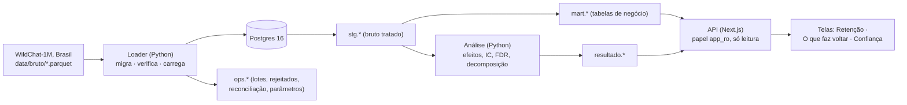
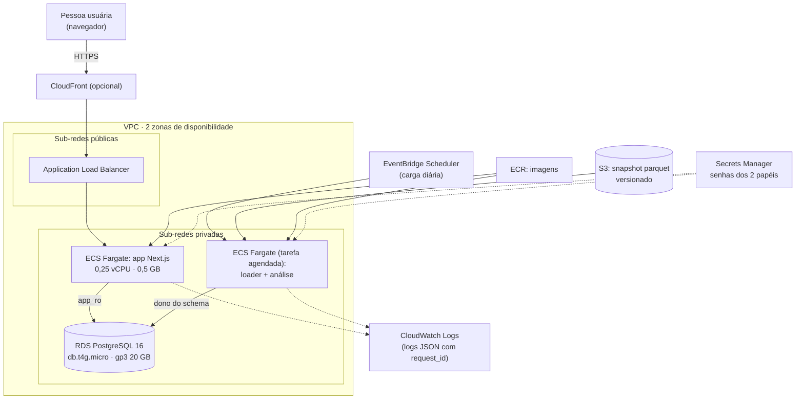

# Arquitetura, implantação na AWS e custo (T-602)

Este documento descreve (1) como o dado anda do arquivo bruto até a tela, (2) como o mesmo sistema seria implantado na AWS e (3) quanto custaria por mês, com as premissas à mostra. O projeto **roda hoje em Docker Compose**; a parte AWS é um desenho dimensionado, **não** uma implantação feita.

## 1. Do dado bruto à tela

Regras que o desenho garante: texto de conversa não entra no Postgres; a aplicação lê só `mart.*` e `resultado.*` com o papel `app_ro`; limiares vêm de `ops.parametros`; toda taxa sai com intervalo e n.

## 2. Implantação na AWS (desenho)

**Deploy:** a imagem do app e a do loader são construídas a partir do mesmo repositório, publicadas no ECR e atualizadas no ECS. O loader roda como tarefa agendada (migra, carrega, transforma, reconcilia) e termina; o app sobe depois que a última carga está registrada em `ops.lote_carga`. Migrações são versionadas em `sql/migrations/` e só o loader as aplica. O app não tem credencial de escrita.

## 3. Componentes e custo mensal estimado

**Como ler os preços.** Valores de referência para a região `us-east-1` (N. Virginia), sob demanda, 730 h/mês, em dólar, **consultados em 11/11/2026**. A página oficial de preços do RDS (<https://aws.amazon.com/rds/postgresql/pricing/>) não exibiu as tabelas de valor na leitura automática feita para este documento; por isso o preço da instância do banco vem de terceiros ([Bytebase](https://www.bytebase.com/dbcost/rds/instance/db.t4g.micro/), [Holori](https://calculator.holori.com/aws/rds/db.t4g.micro)) e os demais são a lista pública de preços de cada serviço, **ainda a conferir no [AWS Pricing Calculator](https://calculator.aws/)** antes de qualquer decisão ou citação. Nenhum valor abaixo veio de uma cobrança real.

| Componente | Para quê | Premissa | Custo/mês (US$) |
|---|---|---|---|
| RDS PostgreSQL 16, `db.t4g.micro`, Single-AZ | Guardar `stg`, `mart`, `resultado`, `ops` | US$ 0,016/h × 730 h (terceiros) | ≈ 11,70 |
| Armazenamento do RDS, gp3 20 GB | A base cabe em poucas centenas de MB; 20 GB é o piso confortável | ≈ US$ 0,115/GB-mês (a conferir) | ≈ 2,30 |
| ECS Fargate, app (0,25 vCPU, 0,5 GB), 1 tarefa 24 h | API + telas | US$ 0,04048/vCPU-h e US$ 0,004445/GB-h (a conferir) | ≈ 9,00 |
| ECS Fargate, loader (0,5 vCPU, 1 GB), ~10 min/dia | Carga e análise diárias | mesmos preços; 5 h/mês | ≈ 0,30 |
| Application Load Balancer | Entrada HTTPS | ≈ US$ 0,0225/h + capacidade baixa (a conferir) | ≈ 18,00 |
| S3 (snapshot parquet, < 1 GB) | Dado bruto versionado | ≈ US$ 0,023/GB-mês | < 0,10 |
| ECR (2 imagens, < 2 GB) | Imagens | ≈ US$ 0,10/GB-mês | ≈ 0,20 |
| Secrets Manager (2 segredos) | Senhas dos papéis | ≈ US$ 0,40/segredo-mês | ≈ 0,80 |
| CloudWatch Logs (< 1 GB/mês) | Logs JSON | ≈ US$ 0,50/GB ingerido | ≈ 0,50 |
| NAT / saída para a internet | Imagens e pacotes | **Evitar**: endpoints de VPC ou sub-redes públicas com IP restrito; um NAT Gateway custaria ≈ 33 | 0 (com a escolha acima) |
| **Total estimado** | | | **≈ 43** |

**Premissas do total:** um país (Brasil), ~11,6 mil conversas, poucas pessoas acessando ao mesmo tempo, sem Multi-AZ, sem CloudFront pago além da camada gratuita, sem tráfego de saída relevante. A API já responde com `Cache-Control` para CDN; o app mede p50 de poucos milissegundos com cache quente (ver `docs/desempenho.md`).

**O que muda o custo:**
- Banco com alta disponibilidade (Multi-AZ) dobra a linha do RDS (≈ +14).
- Banco reservado por 1 ano reduz a linha do RDS em cerca de 30% (valor de terceiros, a conferir).
- Retirar o ALB e servir pelo CloudFront direto ao Fargate economiza a maior linha, ao custo de mais configuração.
- Um NAT Gateway, se necessário, é a maior surpresa possível (≈ +33).

## 4. Outros países

O desenho já separa o país como parâmetro (`pais` na API e nas tabelas), então outro país entra como **nova carga no mesmo banco**, não como novo sistema:
- 1 arquivo bruto por país no S3; o loader recebe o país e grava com a coluna `pais`.
- Os mesmos `mart.*` e `resultado.*` servem a todos; a API filtra por `pais`.
- A análise roda por país, com limiares de amostra iguais (vêm de `ops.parametros`), porque amostras menores aparecem como "amostra pequena" em vez de número firme.
- Cuidados: idioma e fuso horário mudam a definição de "dia"; a taxonomia de temas e as regras de recusa precisam de validação manual por idioma.
- Custo: a base cresce pouco por país; a 5 países o RDS continua na mesma classe de instância até a carga e a análise ficarem lentas. O primeiro limite provável é a análise, não o armazenamento.
