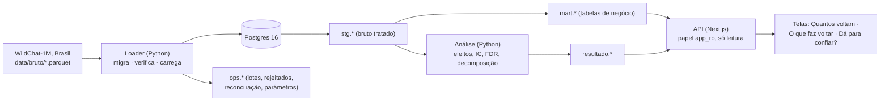
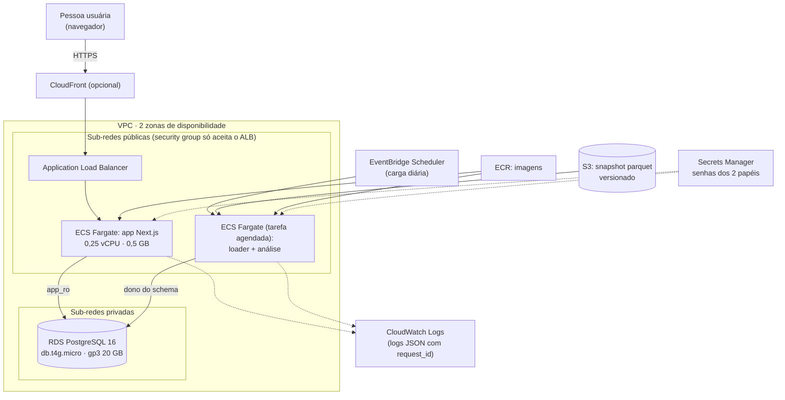

# Arquitetura, implantação na AWS e custo (T-602)

Este documento descreve (1) como o dado anda do arquivo bruto até a tela, (2) como o mesmo sistema seria implantado na AWS e (3) quanto custaria por mês, com as premissas à mostra. O projeto **roda hoje em Docker Compose**; a parte AWS é um desenho dimensionado, **não** uma implantação feita.

## 1. Do dado bruto à tela

Regras que o desenho garante: texto de conversa não entra no Postgres; a aplicação lê só `mart.*` e `resultado.*` com o papel `app_ro`; limiares vêm de `ops.parametros`; toda taxa sai com intervalo e n.

Imagem: `docs/arquitetura/fluxo-bruto-tela.png` (gerada por `scripts/gerar_diagrama_fluxo.py`, com os nomes das telas lidos de `app/mensagens/pt.json`).

## 2. Implantação na AWS (desenho)

Imagem: `docs/arquitetura/implantacao-aws.png`.

**Deploy:** a imagem do app e a do loader são construídas a partir do mesmo repositório, publicadas no ECR e atualizadas no ECS. O loader roda como tarefa agendada (migra, carrega, transforma, reconcilia) e termina; o app sobe depois que a última carga está registrada em `ops.lote_carga`. Migrações são versionadas em `sql/migrations/` e só o loader as aplica. O app não tem credencial de escrita. As tarefas ficam em sub-rede pública (IPv4 público, para falar com ECR, Secrets Manager e CloudWatch sem NAT nem endpoints), com security group que só aceita tráfego do ALB; o banco fica em sub-rede privada.

## 3. Componentes e custo mensal estimado

**Como ler os preços.** Região `us-east-1` (N. Virginia), preço sob demanda, 730 h/mês, em dólar, **consultados em 12/11/2026** na **Price List API pública da AWS** (a mesma base das páginas oficiais de preço; os arquivos de cada serviço trazem a data de publicação citada na coluna "Fonte"). Os valores foram lidos direto desses arquivos oficiais; nenhum vem de terceiros. A seleção do perfil (0,25 vCPU e 0,25 LCU médio no ALB, entre outras) é premissa deste desenho, e **nenhum valor abaixo veio de uma cobrança real**. Onde a fonte oficial não foi consultada, a linha diz "não conferido na fonte oficial".

| Componente | Para quê | Premissa e preço unitário | Custo/mês (US$) | Fonte (Price List API, consulta 12/11/2026) |
|---|---|---|---|---|
| RDS PostgreSQL 16, `db.t4g.micro`, Single-AZ | Guardar `stg`, `mart`, `resultado`, `ops` | US$ 0,016/h × 730 h | 11,68 | [AmazonRDS](https://pricing.us-east-1.amazonaws.com/offers/v1.0/aws/AmazonRDS/current/us-east-1/index.json) · publ. 12/11/2026 · página: <https://aws.amazon.com/rds/postgresql/pricing/> |
| Armazenamento do RDS, gp3 20 GB | A base cabe em poucas centenas de MB; 20 GB é o piso confortável | US$ 0,115/GB-mês × 20 | 2,30 | AmazonRDS (mesma fonte, `RDS:GP3-Storage`, PostgreSQL, Single-AZ) |
| ECS Fargate, app (0,25 vCPU, 0,5 GB), 1 tarefa 24 h | API + telas | US$ 0,04048/vCPU-h × 0,25 × 730 = 7,39 + US$ 0,004445/GB-h × 0,5 × 730 = 1,62 | 9,01 | [AmazonECS](https://pricing.us-east-1.amazonaws.com/offers/v1.0/aws/AmazonECS/current/us-east-1/index.json) · publ. 11/11/2026 · página: <https://aws.amazon.com/fargate/pricing/> |
| ECS Fargate, loader (0,5 vCPU, 1 GB), ~10 min/dia | Carga e análise diárias | mesmos preços × 5 h/mês: 0,10 + 0,02 | 0,12 | AmazonECS (mesma fonte) |
| Application Load Balancer | Entrada HTTPS | US$ 0,0225/h × 730 = 16,43 + US$ 0,008/LCU-h, premissa de 0,25 LCU médio (tráfego baixo) = 1,46 | 17,89 | [AWSELB](https://pricing.us-east-1.amazonaws.com/offers/v1.0/aws/AWSELB/current/us-east-1/index.json) · publ. 11/11/2026 · página: <https://aws.amazon.com/elasticloadbalancing/pricing/> |
| S3 (snapshot parquet, ≤ 1 GB) | Dado bruto versionado | US$ 0,023/GB-mês × 1 | 0,02 | [AmazonS3](https://pricing.us-east-1.amazonaws.com/offers/v1.0/aws/AmazonS3/current/us-east-1/index.json) · publ. 09/11/2026 · página: <https://aws.amazon.com/s3/pricing/> |
| ECR (2 imagens, ≈ 2 GB) | Imagens | US$ 0,10/GB-mês × 2 | 0,20 | [AmazonECR](https://pricing.us-east-1.amazonaws.com/offers/v1.0/aws/AmazonECR/current/us-east-1/index.json) · publ. 11/11/2026 · página: <https://aws.amazon.com/ecr/pricing/> |
| Secrets Manager (2 segredos) | Senhas dos papéis | US$ 0,40/segredo-mês × 2 (chamadas de API: US$ 0,05 por 10 mil, desprezível) | 0,80 | [AWSSecretsManager](https://pricing.us-east-1.amazonaws.com/offers/v1.0/aws/AWSSecretsManager/current/us-east-1/index.json) · publ. 11/11/2026 · página: <https://aws.amazon.com/secrets-manager/pricing/> |
| CloudWatch Logs (≤ 1 GB/mês) | Logs JSON | US$ 0,50/GB ingerido × 1 (classe Standard) | 0,50 | [AmazonCloudWatch](https://pricing.us-east-1.amazonaws.com/offers/v1.0/aws/AmazonCloudWatch/current/us-east-1/index.json) · publ. 04/11/2026 · página: <https://aws.amazon.com/cloudwatch/pricing/> |
| Saída para a internet: IPv4 público (tarefas em sub-rede pública, security group restrito) | Baixar imagens do ECR, falar com Secrets Manager e CloudWatch | US$ 0,005/h por IPv4 público em uso × 730 = 3,65: 1 da tarefa do app + 2 do ALB (2 zonas de disponibilidade assumidas) = 10,95; o loader tem IP só nas 5 h/mês em que roda = 0,03 | 10,98 | [AmazonVPC](https://pricing.us-east-1.amazonaws.com/offers/v1.0/aws/AmazonVPC/current/us-east-1/index.json) · `PublicIPv4:InUseAddress` · publ. 05/11/2026 · página: <https://aws.amazon.com/vpc/pricing/> |
| CloudFront (opcional) | Camada na frente do ALB | Fora do total; a camada gratuita **não foi conferida na fonte oficial** | 0 (não incluído) | não conferido |
| **Total estimado** | | Soma das linhas acima: 11,68 + 2,30 + 9,01 + 0,12 + 17,89 + 0,02 + 0,20 + 0,80 + 0,50 + 10,98 | **53,50 (≈ 54)** | |

**Premissas do total:** um país (Brasil), ~11,6 mil conversas, poucas pessoas acessando ao mesmo tempo, sem Multi-AZ, sem CloudFront, sem NAT Gateway, sem tráfego de saída relevante (transferência de dados não foi precificada). A API já responde com `Cache-Control` para CDN; o app mede p50 de poucos milissegundos com cache quente (ver `docs/desempenho.md`).

**O que muda o custo** (mesma fonte AmazonRDS, 12/11/2026):
- Banco Multi-AZ: a instância passa a US$ 0,032/h = 23,36/mês, ou seja **+11,68** (o armazenamento Multi-AZ tem preço próprio e não foi somado aqui).
- Banco reservado por 1 ano, padrão, sem pagamento antecipado: US$ 0,0116/h = 8,47/mês contra 11,68, **desconto de 27,5% (−3,21/mês)**. Com pagamento parcial antecipado (US$ 49 + US$ 0,0056/h) o equivalente é ≈ 8,17/mês; com tudo antecipado (US$ 95), ≈ 7,92/mês.
- Retirar o ALB e servir pelo CloudFront direto ao Fargate economiza a maior linha (≈ 17,89), ao custo de mais configuração.
- **Por que sub-rede pública e não endpoints de VPC:** com o app e o loader em sub-redes privadas e sem NAT, seriam necessários 4 endpoints de interface (ECR api, ECR dkr, CloudWatch Logs, Secrets Manager), cobrados a US$ 0,01/h por endpoint e por zona: 4 × 2 × 0,01 × 730 = **58,40/mês**, mais os 2 IPv4 do ALB (7,30), ou seja ≈ 65,70 contra 10,98 da escolha adotada (mesma fonte AmazonVPC, `VpcEndpoint-Hours`, US$ 0,01/h; dados processados a US$ 0,01/GB, desprezíveis aqui). O endpoint de gateway do S3 não tem linha de cobrança no arquivo de preços, mas a gratuidade em si não foi conferida na página.
- **NAT Gateway:** não usado. Seu preço **não está** no arquivo AmazonVPC da Price List API, então segue **não conferido na fonte oficial**.

## 4. Outros países

O desenho já separa o país como parâmetro (`pais` na API e nas tabelas), então outro país entra como **nova carga no mesmo banco**, não como novo sistema:
- 1 arquivo bruto por país no S3; o loader recebe o país e grava com a coluna `pais`.
- Os mesmos `mart.*` e `resultado.*` servem a todos; a API filtra por `pais`.
- A análise roda por país, com limiares de amostra iguais (vêm de `ops.parametros`), porque amostras menores aparecem como "pouca gente" em vez de número firme.
- Cuidados: idioma e fuso horário mudam a definição de "dia"; a taxonomia de temas e as regras de recusa precisam de validação manual por idioma.
- **Idioma da interface:** os textos das telas já ficam fora do código, em `app/mensagens/pt.json` (lidos por `app/lib/mensagens.ts`); outro idioma é outro arquivo, escolhido pelo país, com números no formato local.
- **Fuso de cada país:** `fuso_pais` em `ops.parametros` define a semana da coorte, o "dia" e o período do dia; país com mais de um fuso usa o da capital, com a premissa registrada.
- **Comparação entre países:** a taxa bruta lado a lado engana se o público for diferente; a comparação usa a mesma decomposição mix × taxa da semana (seção 5 do `entrega.md`), com intervalo e n de cada país.
- Custo: a base cresce pouco por país; a 5 países o RDS continua na mesma classe de instância até a carga e a análise ficarem lentas. O primeiro limite provável é a análise, não o armazenamento.

## 5. Modelo da base analítica

Quatro esquemas no Postgres, cada um com um papel de acesso (`sql/migrations/`, `sql/transform/`):

| Esquema | Tabela | Grão (uma linha por) | Para quê |
|---|---|---|---|
| `ops` | `parametros` | chave da definição | limiares versionados (janela, gap de sessão, n mínimo, fuso) |
| `ops` | `lote_carga` | execução da carga | origem, checksum, linhas lidas/gravadas/rejeitadas, versão da definição |
| `ops` | `rejeitado` | conversa rejeitada | motivo da rejeição |
| `ops` | `reconciliacao` | métrica × lote | bruto × base, diferença e tolerância (9 métricas) |
| `stg` | `conversa` | conversa | variáveis derivadas na carga; **sem texto de conversa**; só o `loader_rw` lê |
| `mart` | `fct_sessao` | usuário × sessão | sessões pelo gap de 30 min |
| `mart` | `dim_usuario` | usuário | primeira sessão, coorte, elegibilidade e motivo |
| `mart` | `fct_primeira_experiencia` | usuário | variáveis da 1ª experiência e retorno em 7 dias |
| `mart` | `agg_retencao_periodo` | semana ou mês | novos, voltaram, taxa, IC, maturidade, amostra suficiente |
| `mart` | `agg_retencao_sensibilidade` | definição alternativa | taxa por definição e diferença para a oficial |
| `mart` | `agg_retencao_segmento` | variável × valor | taxa por segmento, com IC |
| `mart` | `dim_era_modelo` | era de oferta de modelo | faixas do gráfico |
| `mart` | `dicionario_indicador` | indicador | definição, fórmula, denominador, período, fonte e SQL |
| `resultado` | `efeito_fator`, `sensibilidade_efeito`, `balanco_propensao` | fator / definição / covariável | efeitos bruto e ajustado com IC, robustez, balanço |
| `resultado` | `decomposicao_resumo`, `decomposicao_semana` | semana / segmento | mix × taxa |
| `resultado` | `achado`, `problema_qualidade`, `validacao_classificador`, `meta` | achado / problema / classificador | textos e conferências exibidos nas telas |

Colunas do `resultado.achado` além do texto longo (evidência, decisão, limite): `numero_destaque` e `rotulo_destaque` (número grande do cartão), `acao_curta` ("O que fazer" em uma frase), `vimos_curto` e `limite_curto` ("O que vimos" e "Cuidado" em uma frase) e `tecnico` (bloco recolhido "Para conferir (técnico)"). Vêm das migrações 012 (destaque e ação curta), 013 (técnico) e 014 (frases curtas); todas opcionais, então o texto longo aprovado não muda.

O `resultado.validacao_classificador.detalhe_json` guarda, ao lado da matriz de confusão e dos valores por classe, as **métricas ponderadas** (`ponderadas`: precisão e cobertura da recusa e acurácia do assunto). A amostra conferida à mão (200 conversas) foi estratificada por recusa e assunto previstos pelas regras; cada conversa pesa `N do estrato ÷ n do estrato`, e o cartão "Quando a IA aponta recusa, acerta" mostra as ponderadas (as cruas ficam no detalhe técnico).

A aplicação (papel `app_ro`) só tem `SELECT` em `mart.*`, `resultado.*` e, para o rodapé e a tela de confiança, em `ops.lote_carga` e `ops.reconciliacao` (migrações 002 e 020); nada de `stg`.

## 6. Telas

Três telas em Next.js (`app/app/`), todas em formato de painel (cabem numa dobra a 1280×720, 1536×647 e 1366×650):

| Rota | Nome | O que mostra |
|---|---|---|
| `/` | **Quantos voltam** | a taxa de retorno em 7 dias por mês ou por semana, com margem de erro, e as duas semanas de queda |
| `/fatores` | **O que faz voltar** | ranking de comparações entre pessoas parecidas, em quatro abas, e três achados para o produto |
| `/dados` | **Dá para confiar?** | carga, conferências, problemas encontrados nos dados e acerto da IA |

Tudo o que é explicação, definição e método abre numa caixa central (`app/components/CaixaDetalhe.tsx`): cresce do ponto do clique, fecha com Esc ou clique fora, devolve o foco a quem a abriu e respeita "reduzir movimento" do sistema. Os textos das telas ficam em `app/mensagens/pt.json`.

## 7. Endpoints

Todos são `GET`, devolvem `{dados, meta}` (o `meta` traz versão da definição, versão da análise e último lote) e erro padronizado com `request_id`. Código em `app/app/api/`.

| Rota | Entrada (query) | Saída (`dados`) |
|---|---|---|
| `/api/retencao/resumo` | `pais` | usuários, voltaram, taxa, IC, período, efeito mínimo detectável |
| `/api/retencao/coortes` | `pais`, `inicio`, `fim`, `granularidade` (`semana`/`mes`) | por período: novos, voltaram, taxa, IC, média móvel, madura, amostra suficiente; `meta.eras` |
| `/api/retencao/sensibilidade` | `pais` | por definição: usuários, taxa, IC, diferença para a oficial |
| `/api/fatores/efeitos` | `pais`, `grupo?` (`assistente`/`perfil`/`engajamento`) | efeitos bruto e ajustado com IC e n |
| `/api/fatores/segmentos` | `pais`, `variavel` | por valor: novos, voltaram, taxa, IC, amostra suficiente |
| `/api/fatores/balanco` | `pais`, `tratamento` | por covariável: diferença padronizada antes e depois |
| `/api/semana/decomposicao` | `pais`, `semana` | resumo (mix × taxa) e segmentos |
| `/api/achados` | `pais` | ordem, título, evidência, decisão, limite |
| `/api/qualidade` | `pais` | lote, reconciliação, problemas, validação do classificador |
| `/api/dicionario` | `indicador?` | ficha completa de cada indicador, com o SQL |
| `/api/saude` | — | ok, banco, último lote, versão da definição |

Regras: `inicio`/`fim` opcionais, `fim` exclusivo, intervalo invertido devolve 400; abaixo do n mínimo a linha sai com `amostra_suficiente: false` e a tela decide ocultar.
