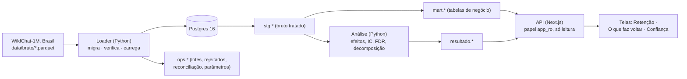
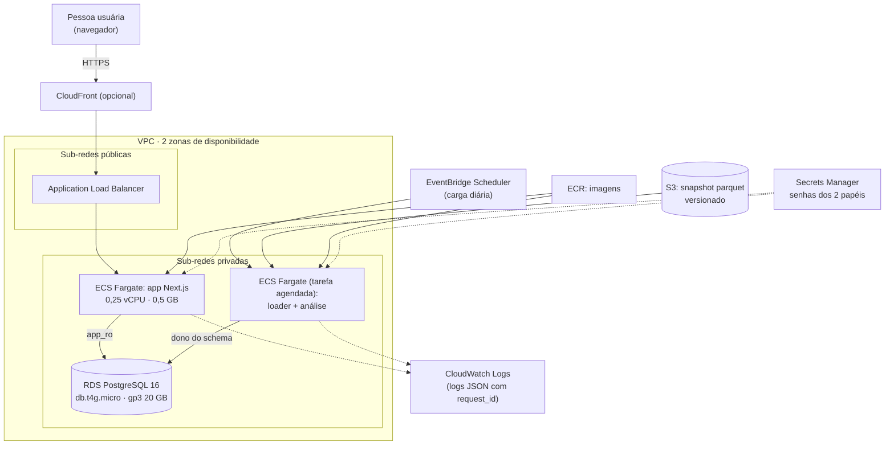

# Arquitetura, implantação na AWS e custo (T-602)

Este documento descreve (1) como o dado anda do arquivo bruto até a tela, (2) como o mesmo sistema seria implantado na AWS e (3) quanto custaria por mês, com as premissas à mostra. O projeto **roda hoje em Docker Compose**; a parte AWS é um desenho dimensionado, **não** uma implantação feita.

## 1. Do dado bruto à tela

Regras que o desenho garante: texto de conversa não entra no Postgres; a aplicação lê só `mart.*` e `resultado.*` com o papel `app_ro`; limiares vêm de `ops.parametros`; toda taxa sai com intervalo e n.

Imagem: `docs/arquitetura/fluxo-bruto-tela.png`.

## 2. Implantação na AWS (desenho)

Imagem: `docs/arquitetura/implantacao-aws.png`.

**Deploy:** a imagem do app e a do loader são construídas a partir do mesmo repositório, publicadas no ECR e atualizadas no ECS. O loader roda como tarefa agendada (migra, carrega, transforma, reconcilia) e termina; o app sobe depois que a última carga está registrada em `ops.lote_carga`. Migrações são versionadas em `sql/migrations/` e só o loader as aplica. O app não tem credencial de escrita.

## 3. Componentes e custo mensal estimado

**Como ler os preços.** Região `us-east-1` (N. Virginia), preço sob demanda, 730 h/mês, em dólar, **consultados em 12/11/2026** na **Price List API pública da AWS** (a mesma base das páginas oficiais de preço; os arquivos de cada serviço trazem a data de publicação citada na coluna "Fonte"). Os valores foram lidos direto desses arquivos oficiais; nenhum vem de terceiros. A seleção do perfil (0,25 vCPU, 1 LCU etc.) é premissa deste desenho, e **nenhum valor abaixo veio de uma cobrança real**. Onde a fonte oficial não foi consultada, a linha diz "não conferido na fonte oficial".

| Componente | Para quê | Premissa e preço unitário | Custo/mês (US$) | Fonte (Price List API, consulta 12/11/2026) |
|---|---|---|---|---|
| RDS PostgreSQL 16, `db.t4g.micro`, Single-AZ | Guardar `stg`, `mart`, `resultado`, `ops` | US$ 0,016/h × 730 h | 11,68 | [AmazonRDS](https://pricing.us-east-1.amazonaws.com/offers/v1.0/aws/AmazonRDS/current/us-east-1/index.json) · publ. 12/11/2026 · página: <https://aws.amazon.com/rds/postgresql/pricing/> |
| Armazenamento do RDS, gp3 20 GB | A base cabe em poucas centenas de MB; 20 GB é o piso confortável | US$ 0,115/GB-mês × 20 | 2,30 | AmazonRDS (mesma fonte, `RDS:GP3-Storage`, PostgreSQL, Single-AZ) |
| ECS Fargate, app (0,25 vCPU, 0,5 GB), 1 tarefa 24 h | API + telas | US$ 0,04048/vCPU-h × 0,25 × 730 = 7,39 + US$ 0,004445/GB-h × 0,5 × 730 = 1,62 | 9,01 | [AmazonECS](https://pricing.us-east-1.amazonaws.com/offers/v1.0/aws/AmazonECS/current/us-east-1/index.json) · publ. 11/11/2026 · página: <https://aws.amazon.com/fargate/pricing/> |
| ECS Fargate, loader (0,5 vCPU, 1 GB), ~10 min/dia | Carga e análise diárias | mesmos preços × 5 h/mês: 0,10 + 0,02 | 0,12 | AmazonECS (mesma fonte) |
| Application Load Balancer | Entrada HTTPS | US$ 0,0225/h × 730 = 16,43 + US$ 0,008/LCU-h, premissa de 0,25 LCU médio (tráfego baixo) = 1,46 | 17,89 | [AWSELB](https://pricing.us-east-1.amazonaws.com/offers/v1.0/aws/AWSELB/current/us-east-1/index.json) · publ. 11/11/2026 · página: <https://aws.amazon.com/elasticloadbalancing/pricing/> |
| S3 (snapshot parquet, ≤ 1 GB) | Dado bruto versionado | US$ 0,023/GB-mês × 1 | 0,02 | [AmazonS3](https://pricing.us-east-1.amazonaws.com/offers/v1.0/aws/AmazonS3/current/us-east-1/index.json) · publ. 09/11/2026 · página: <https://aws.amazon.com/s3/pricing/> |
| ECR (2 imagens, ≈ 2 GB) | Imagens | US$ 0,10/GB-mês × 2 | 0,20 | [AmazonECR](https://pricing.us-east-1.amazonaws.com/offers/v1.0/aws/AmazonECR/current/us-east-1/index.json) · publ. 11/11/2026 · página: <https://aws.amazon.com/ecr/pricing/> |
| Secrets Manager (2 segredos) | Senhas dos papéis | US$ 0,40/segredo-mês × 2 (chamadas de API: US$ 0,05 por 10 mil, desprezível) | 0,80 | [AWSSecretsManager](https://pricing.us-east-1.amazonaws.com/offers/v1.0/aws/AWSSecretsManager/current/us-east-1/index.json) · publ. 11/11/2026 · página: <https://aws.amazon.com/secrets-manager/pricing/> |
| CloudWatch Logs (≤ 1 GB/mês) | Logs JSON | US$ 0,50/GB ingerido × 1 (classe Standard) | 0,50 | [AmazonCloudWatch](https://pricing.us-east-1.amazonaws.com/offers/v1.0/aws/AmazonCloudWatch/current/us-east-1/index.json) · publ. 04/11/2026 · página: <https://aws.amazon.com/cloudwatch/pricing/> |
| NAT / saída para a internet | Imagens e pacotes | **Evitar**: endpoints de VPC ou sub-redes públicas com IP restrito. Preço do NAT Gateway: **não conferido na fonte oficial** (o arquivo de preços do EC2 é grande demais para esta máquina; o valor de ≈ US$ 33/mês citado antes era de memória e foi retirado) | 0 (com a escolha acima) | não conferido |
| CloudFront (opcional) | Camada na frente do ALB | Fora do total; a camada gratuita **não foi conferida na fonte oficial** | 0 (não incluído) | não conferido |
| **Total estimado** | | Soma das linhas acima: 11,68 + 2,30 + 9,01 + 0,12 + 17,89 + 0,02 + 0,20 + 0,80 + 0,50 | **42,52 (≈ 43)** | |

**Premissas do total:** um país (Brasil), ~11,6 mil conversas, poucas pessoas acessando ao mesmo tempo, sem Multi-AZ, sem CloudFront, sem tráfego de saída relevante (transferência de dados não foi precificada). A API já responde com `Cache-Control` para CDN; o app mede p50 de poucos milissegundos com cache quente (ver `docs/desempenho.md`).

**O que muda o custo** (mesma fonte AmazonRDS, 12/11/2026):
- Banco Multi-AZ: a instância passa a US$ 0,032/h = 23,36/mês, ou seja **+11,68** (o armazenamento Multi-AZ tem preço próprio e não foi somado aqui).
- Banco reservado por 1 ano, padrão, sem pagamento antecipado: US$ 0,0116/h = 8,47/mês contra 11,68, **desconto de 27,5% (−3,21/mês)**. Com pagamento parcial antecipado (US$ 49 + US$ 0,0056/h) o equivalente é ≈ 8,17/mês; com tudo antecipado (US$ 95), ≈ 7,92/mês.
- Retirar o ALB e servir pelo CloudFront direto ao Fargate economiza a maior linha (≈ 17,89), ao custo de mais configuração.
- Um NAT Gateway, se necessário, é a maior surpresa possível; seu preço **não foi conferido** aqui.

## 4. Outros países

O desenho já separa o país como parâmetro (`pais` na API e nas tabelas), então outro país entra como **nova carga no mesmo banco**, não como novo sistema:
- 1 arquivo bruto por país no S3; o loader recebe o país e grava com a coluna `pais`.
- Os mesmos `mart.*` e `resultado.*` servem a todos; a API filtra por `pais`.
- A análise roda por país, com limiares de amostra iguais (vêm de `ops.parametros`), porque amostras menores aparecem como "amostra pequena" em vez de número firme.
- Cuidados: idioma e fuso horário mudam a definição de "dia"; a taxonomia de temas e as regras de recusa precisam de validação manual por idioma.
- Custo: a base cresce pouco por país; a 5 países o RDS continua na mesma classe de instância até a carga e a análise ficarem lentas. O primeiro limite provável é a análise, não o armazenamento.
