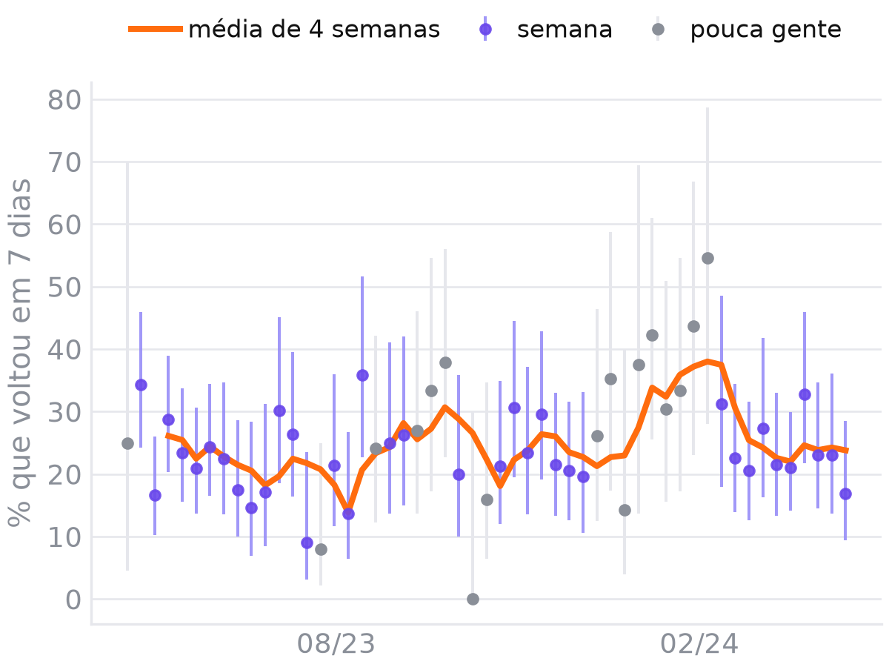
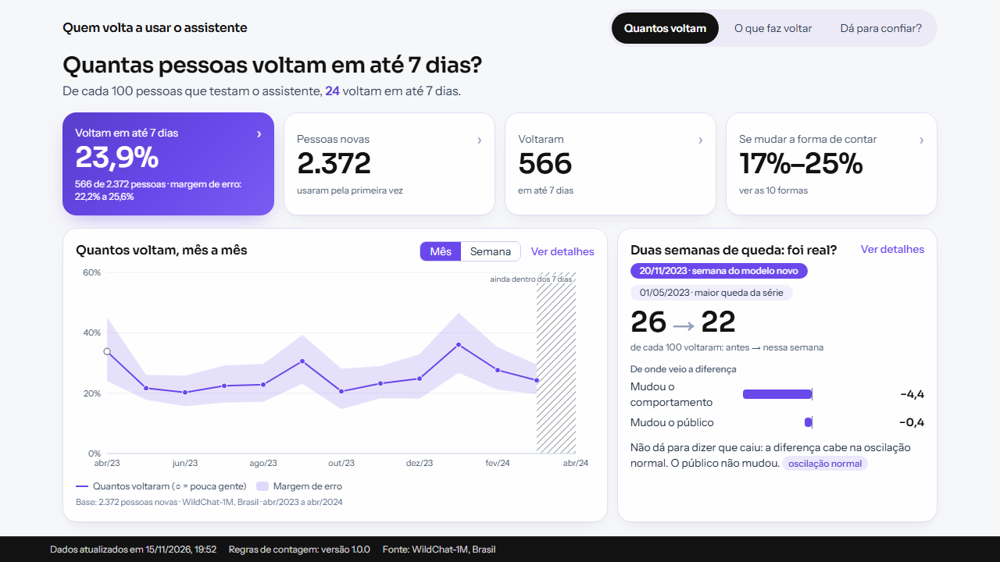
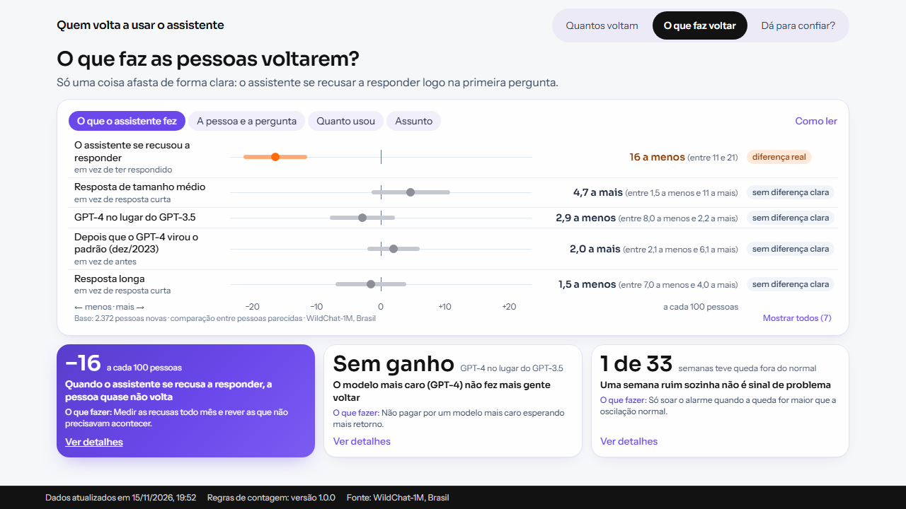
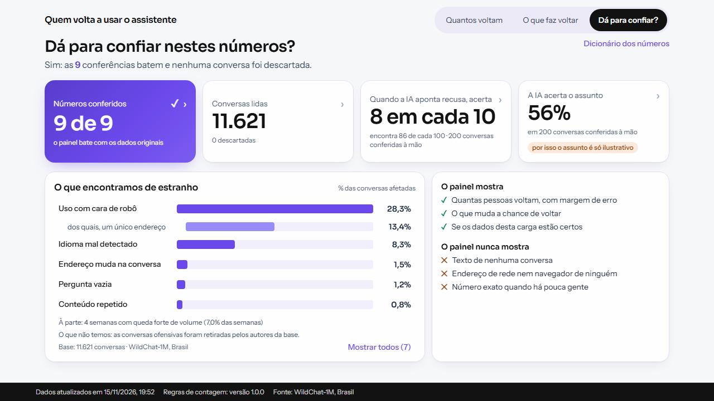

# O que faz uma pessoa voltar ao assistente em até 7 dias

Vinícius Souza · Desafio técnico Acaso · novembro de 2026

## A resposta em uma página

> De cada 100 pessoas que experimentam o assistente, **24 voltam em até 7 dias**. Só uma coisa que o assistente faz afasta de forma clara: **recusar a primeira pergunta**.

| Número | O que é | Base |
|---|---|---|
| **23,9%** | voltam em até 7 dias | 566 de 2.372 pessoas · margem de erro: 22,2% a 25,6% |
| **−16** | voltam a menos, a cada 100, depois de uma recusa | entre 11 e 21 · comparando pessoas parecidas |
| **Sem ganho** | de retorno com o GPT-4 no lugar do GPT-3.5 | −2,9 pontos (de −8,0 a +2,2) |
| **1 de 33** | semanas com queda fora do normal | o acaso sozinho produz cerca de 2 |

| Achado | O que vi | Decisão que sustenta | Limite |
|---|---|---|---|
| **1. A recusa afasta** | Dos 132 que receberam recusa na primeira resposta, 13 voltaram (9,8%). Dos outros 2.240, voltaram 553 (24,7%). Entre pessoas parecidas, são 16,4 pontos a menos (de 11,5 a 21,4). | Acompanhar a taxa de recusa como indicador de saúde e testar uma recusa que ofereça alternativa. | É comparação, não experimento, e o grupo é pequeno. |
| **2. Modelo mais caro não trouxe retorno** | GPT-4 contra GPT-3.5: 2,9 pontos a menos (de −8,0 a +2,2). Os dados descartam um ganho acima de 2 pontos. | Não justificar um modelo mais caro por retenção. Se a troca vier por qualidade, medir com teste controlado. | Efeito menor que 5 pontos não aparece com esta base. |
| **3. Semana ruim sozinha engana** | A maior queda da série (01/05/2023) era efeito do início da coleta: parecia 17,1 pontos e caiu para 7,7. A de 20/11/2023 caiu 4,9, dentro da variação normal. | O alerta do painel só dispara acima da variação normal. | De 33 a 197 pessoas por semana: só queda grande aparece. |

```fluxo
WildChat-1M, só Brasil: 11.621 conversas -> Definições: pessoa, sessão, voltar -> 2.372 pessoas novas -> 25 comparações entre pessoas parecidas -> 1 se sustenta: a recusa
```

- **O que os dados não permitem:** provar causa, enxergar efeito menor que 5 pontos e reconhecer a mesma pessoa em outra rede ou outro aparelho.
- **O que entrego:** base em Postgres, API e painel com 3 telas, que sobem com `docker compose up`.

## 1. Definições e o que muda se eu estiver errado

> Só uma escolha move o número de verdade: o que se chama de voltar. A resposta honesta para o cliente é "entre 17% e 24%".

Recalculei a taxa com cada definição alternativa, usando a mesma função. A oficial é 23,86%.

| Premissa | Escolha | Com a alternativa |
|---|---|---|
| Quem é um usuário | IP + família do navegador, sem versão | só IP: 23,94% · IP + navegador completo: 25,14% |
| Sessão | até 30 min entre o fim de uma conversa e o início da próxima | 60 min: 21,54% |
| Voltar | nova sessão iniciada em até 7 dias (168 h) | só em outro dia: 16,86% |
| O que conta como uso | ao menos 1 pergunta não vazia e 1 resposta | contando as vazias: 23,69% |
| Início da base | os 14 primeiros dias ficam fora, e também quem não completou 7 dias | sem o corte: 24,01% · com 28 dias: 23,70% |
| Tráfego anômalo | IP com 200 ou mais conversas, ou 10 ou mais navegadores, fica fora (11 usuários) | com eles: 24,08% |
| Fuso | America/Sao_Paulo | UTC: mesma taxa; 44 usuários mudam de semana |

As outras escolhas mexem menos de 2,5 pontos. Cada uma tem registro em `docs/decisoes/` (BDR-01 a BDR-07), com as opções que considerei.

## 2. O que os dados mostram

> O uso é concentrado em poucos IPs, as conversas são curtas e cada semana tem pouca gente. Boa parte do sobe e desce semanal é ruído.





**Variáveis da primeira experiência e como cada uma é derivada** (`loader/derivar.py`; definições no dicionário do painel):

| Variável | Como é derivada |
|---|---|
| Modelo | família do modelo da primeira conversa: GPT-3.5 (1.340 pessoas) ou GPT-4 (1.032) |
| Tema | classificado por LLM em 8 grupos, conferido à mão |
| Tamanho | caracteres da primeira pergunta e da primeira resposta, em faixas |
| Qualidade da resposta | não existe nota do usuário; uso dois sinais: recusa e resposta em idioma diferente do da pergunta |
| Recusa | a primeira resposta é uma recusa, segundo o LLM, conferido à mão |
| Número de turnos | trocas na primeira sessão. Acontece depois da resposta, então trato como sinal de interesse, não como fator do assistente. Quem tem 4 ou mais volta 32,9%, contra 17,2% de quem teve um |
| Horário | período do dia e fim de semana, no fuso de São Paulo |
| Idioma | idioma detectado na primeira pergunta |
| Aparelho e região | celular ou computador, pelo navegador; região pelo estado que vem na base |

**Como conferi a classificação por IA:**

- Rotulei 200 conversas à mão, sem ver a resposta da máquina.
- Recusa: as regras de palavras-chave acertavam 81% das 200 conversas; o LLM (Claude Haiku) acertou 92%. O número que vale para a base é o ponderado, porque a amostra foi montada com mais casos suspeitos: de cada 10 recusas que o LLM aponta, cerca de 8 são recusas de fato, e ele encontra cerca de 86 de cada 100. Com só 20 recusas reais na amostra, essa margem é larga.
- Tema: 37% com as regras e 56% com o LLM. Por isso o tema fica só como descrição.
- A troca mudou o resultado: com as regras, o efeito da recusa parecia 3,3 pontos e não se distinguia de zero. Detalhe em `docs/validacao_llm.md`.

**Problemas de qualidade e o que fiz com cada um:**

| Problema | Tamanho | Tratamento |
|---|---|---|
| Uso com cara de robô | 7 IPs, 3.284 conversas (28,3%) | fora da conta; testei também incluindo |
| Idioma mal detectado em pergunta curta | 964 conversas | o fator "idioma diferente" só usa perguntas com mais de 30 caracteres |
| IP muda no meio da conversa | 175 conversas | uso o IP mais frequente da conversa |
| Pergunta vazia | 141 conversas | mantidas; só conta como uso se houver pergunta não vazia |
| Texto repetido | 93 conversas | mantidas e contadas separadamente |
| Dado pessoal removido pelos autores | 56 conversas | mantidas |
| Conversas tóxicas removidas na origem | não sei quantas | não tenho; é nelas que a recusa é mais comum |

- **Dá para medir:** quem volta, com margem de erro, e o que anda junto com voltar.
- **Não dá:** provar causa, nem saber por que a pessoa parou.
- **Dados que faltam:** ID de login, versão do produto por data, satisfação declarada e o motivo da saída.

## 3. O que pesa no retorno

> Dos 25 efeitos entre pessoas parecidas, só a recusa passa a correção para muitos testes.

Diferença na taxa de retorno, em pontos percentuais. O ajustado compara pessoas parecidas nos outros fatores, por regressão logística com erro agrupado por IP.

| Fator | Bruto | Ajustado (intervalo de 95%) | Leitura |
|---|---:|---|---|
| Recusa na 1ª resposta | −14,8 | **−16,4 (−21,4 a −11,5)** | se sustenta |
| Tema: conversa pessoal | −10,0 | −8,2 (−14,3 a −2,1) | não passa a correção; tema é descritivo |
| Resposta de 301 a 1.000 caracteres | +8,8 | +4,7 (−1,5 a +10,8) | o bruto enganava |
| Modelo GPT-4 contra GPT-3.5 | +0,1 | −2,9 (−8,0 a +2,2) | não se distingue de zero |
| Resposta com mais de 2.500 caracteres | +7,9 | +0,5 (−6,0 a +7,0) | o bruto enganava |
| Idioma diferente do da pergunta | +3,0 | +0,1 (−7,7 a +7,9) | não se distingue de zero |

- **Confusão que tratei:** os outros fatores da primeira experiência e a época de chegada entram no modelo, para comparar pessoas parecidas.
- **Causa ou seleção:** no bruto, resposta mais longa parecia trazer 8 pontos de retorno. Entre pessoas parecidas, sobra quase nada. Era o perfil de quem pergunta, não a resposta.
- **Segundo método:** para o modelo e para a troca do modelo padrão em dezembro de 2023, ponderei os grupos até ficarem comparáveis, e a leitura foi a mesma. Para a recusa ele não fecha: com 132 casos não consegui um grupo de comparação equilibrado, e digo isso no painel.
- **Robustez da recusa:** fica entre −14,4 e −16,4 quando troco a definição de usuário, a de sessão ou o corte do início. As 132 recusas vêm de 131 IPs. Testes em `docs/robustez_recusa.md`.
- **O que prova:** que a recusa anda junto de bem menos retorno.
- **O que não prova:** que a recusa cause a saída. Ela pode ser o sinal de um pedido que o produto não atende. Só um teste controlado responde.
- **Tema no painel:** aparece como comparação direta contra todos os outros temas (−9,2 para conversa pessoal). A base de comparação é outra, por isso difere do bruto da tabela.

## 4. A semana que caiu

> Nas duas semanas que analisei, quase toda a diferença é de comportamento, não de público. E nenhuma passa do que a variação normal produz.

Comparei cada semana com 4 semanas de base e separei a diferença em duas partes: mudou quem chegou, ou mudou o comportamento de cada tipo de pessoa.

| Semana | Retorno | Base de comparação | Diferença | Quem chegou / comportamento | p |
|---|---|---|---:|---|---:|
| 20/11/2023 | 21,5% (n = 65) | 26,4% (n = 197), 4 semanas anteriores | −4,9 | −0,4 / −4,4 | 0,43 |
| 01/05/2023 | 16,7% (n = 84) | 24,4% (n = 340), 4 semanas seguintes | −7,7 | −0,6 / −7,1 | 0,13 |

A semana de 01/05 me enganou na primeira leitura: comparada com as duas semanas anteriores, que eram o começo da coleta, parecia a maior queda da série. Por isso a base dela são as semanas seguintes.

## 5. O painel

> Três telas, cada uma com uma pergunta no título e a resposta em uma frase. Cada tela cabe sem rolar, inclusive em notebook.





| Tela | Pergunta que responde | Gráfico e por quê |
|---|---|---|
| Quantos voltam | De cada 100 pessoas, quantas voltam em 7 dias, e isso está mudando? | Linha por mês com faixa de margem de erro, para ninguém ler ponto solto como tendência. Por semana, a linha é a média de 4 semanas e cada semana vira um ponto, porque semana tem pouca gente. Ao lado, a semana que caiu: "26 → 22" e duas barras, público e comportamento |
| O que faz voltar | Quais fatores pesam, e quanto é efeito do assistente? | Uma linha por fator: o ponto é a diferença, a barra é a margem de erro. O que cruza o zero se vê de relance. Abaixo, os três achados com a decisão de cada um |
| Dá para confiar? | Posso confiar nestes números? | Cartões com a conferência contra a origem e a validação da IA; barras com cada problema de qualidade; e a lista do que o painel mostra e do que nunca mostra |

- **Linguagem:** o texto das telas fala de pessoas ("16 a menos voltam, a cada 100"), não de pontos percentuais.
- **Clique:** todo cartão, linha e barra abre uma caixa curta com o número, a explicação e o cuidado na leitura.
- **Indicadores:** definição, fórmula, denominador, período e a consulta SQL de cada um ficam nessa caixa, no bloco "Para conferir (técnico)", e no dicionário da terceira tela.
- **Pouca gente:** o painel escreve "pouca gente" e não tira conclusão. Períodos que não completaram 7 dias aparecem hachurados, nunca como queda.
- **O que nunca mostra:** texto de conversa, IP e navegador não aparecem em nenhuma tela nem na API. O texto de conversa nem entra no banco. Só agregados.

## 6. Arquitetura e custo

> O painel nunca lê o arquivo bruto. Ele lê tabelas prontas, com um usuário de banco que só pode ler.

```fluxo
Arquivo bruto (parquet) -> Carga em Python -> Postgres: dado tratado -> Análise em Python -> Postgres: tabelas finais -> API em Next.js, só leitura -> 3 telas
```

- **Stack:** Postgres, Python na carga e na análise, Next.js na API e nas telas. O porquê de cada escolha está nos ADR-01 a ADR-10.
- **AWS (desenho, não implantei):** RDS PostgreSQL, containers para o app e a carga, balanceador, S3 para o bruto e Bedrock para o LLM. Custo estimado de **US$ 54 por mês**, com a tabela oficial de preços consultada em 12/11/2026.
- **LLM:** custou US$ 0,24 para classificar 2.944 conversas, cerca de US$ 0,08 por mil. Rodei pela OpenRouter, porque o Bedrock ficou bloqueado na minha conta.
- **Desempenho:** os indicadores são calculados na carga; a API guarda as respostas em cache até a carga seguinte; o tempo sai em cada resposta e no log. A consulta principal levava 12 segundos e passou a 0,33. Medidas em `docs/desempenho.md`.
- **Outros países:** o país já é parâmetro na base e na API. Os textos ficam em arquivo por idioma, o fuso é configurado por país e a comparação entre países usa a mesma separação entre público e comportamento da seção 4.
- **Diagramas, modelo da base e endpoints** (nome, entrada e saída): `docs/arquitetura/arquitetura.md`.

## 7. Como eu saberia que um número está errado

> A cada carga, o programa refaz 9 contagens direto do arquivo bruto e compara com a base. Hoje a diferença é zero nas 9.

- **Registro por camada:** cada carga grava arquivo de origem, linhas lidas, gravadas e rejeitadas. Cada resposta da API deixa um log com identificador, tempo e versão dos dados. A tela mostra esse identificador quando dá erro.
- **Caminho de investigação:** tela, log, consulta, tabela, carga, arquivo.
- **Testes que travam as definições:** rodam sobre uma base pequena, inventada, em que eu sei a resposta certa. Retorno em 6 dias e 23 horas conta; em 7 dias e 1 minuto, não. Trocar a versão do navegador não cria usuário novo.
- **Teste dos testes:** quebrei as regras de propósito para ver se eles pegavam. Um não pegava a troca de `<=` por `<` na janela de 7 dias, e acrescentei o que faltava.
- **Até produção:** a mesma imagem passa por local, homologação e produção. Mudança de banco é arquivo SQL numerado, com o passo inverso. Depois de cada implantação rodam a verificação de saúde e a conferência com a origem.
- **Três ressalvas:** o envio automático do alerta está descrito, não construído. Os passos inversos estão escritos, mas não foram executados. A esteira de integração contínua está configurada, mas ainda não rodou.

## 8. O incidente: a retenção caiu de 31% para 18%

> A queda é de contagem, não de comportamento: quem voltou ficou estável; quem chegou quase dobrou, só no painel.

| Semana do incidente | Painel | Relatório do time de dados |
|---|---:|---:|
| Novos | 2.034 | 1.172 |
| Voltaram em 7 dias | 366 | 352 |

- **Por onde eu começaria:** pela comparação acima, das duas fontes, semana a semana. Ela mostra em qual número está a diferença antes de eu abrir qualquer código.
- **Em qual camada:** na carga, na regra que define o usuário. O relatório conta por IP; a carga conta por IP mais o texto completo do navegador.
- **Evidência no dado real:** por IP são 2.385 usuários; por IP mais navegador completo são 2.895, 21% a mais, e um único IP chega a ter 35 navegadores. A consulta de confirmação está em `docs/incidente/confirmacao.sql`.
- **O trecho que causa:** cada atualização do navegador vira uma pessoa nova.

```python
chave = f"{hashed_ip}|{user-agent}"
```

- **A correção** (completa em `docs/incidente/correcao/`): identidade por uma regra única, sem a versão do navegador, usada em todo o sistema, e carga dentro de transação.

```python
chave = "|".join([hashed_ip, familia_so(user_agent), familia_navegador(user_agent)])
```

- **O que mais fazer:** reprocessar o histórico com a regra corrigida. Alinhar a definição de usuário com o time de dados, porque a causa de fundo são duas definições e nenhuma conferência entre elas. Ligar a conferência automática da seção 7. Manter o teste que escrevi para esse caso, que falha se alguém voltar à chave antiga.
- **À gerente de produto, durante:** "A queda é quase certamente de medição. O número de pessoas que voltaram não mudou, só o de pessoas que chegaram. Não tome decisão em cima do 18%. Volto com a causa confirmada até tal hora."
- **Depois:** "Uma troca de navegador estava contando como usuário novo. Corrigimos, a retenção daquela semana é tanto, e os números que você já apresentou mudam assim. Agora a contagem é conferida automaticamente com o relatório do time de dados."

## 9. Riscos e decisões que não são minhas

| Risco | Decisão a levar ao time e ao cliente |
|---|---|
| Sem login, a identidade erra para os dois lados | Qual é a definição oficial de usuário |
| O dado tem texto de conversa e IP | Política de retenção e base legal; o que pode ir para um LLM |
| Mudar o que é voltar muda o número oficial | Quem aprova mudança de definição e como se comunica |
| Com 2.400 usuários só se enxerga efeito grande | Qual tamanho de efeito vale uma ação, e se vale um teste no produto |
| O custo do LLM cresce com a base | Orçamento e quem aprova |
| Carga em lote | Prazo de atualização e o que o painel mostra quando atrasa |

## 10. Sugestões

- **Para o assistente:** revisar as recusas desnecessárias e testar uma recusa que ofereça alternativa. Não trocar de modelo esperando retenção.
- **Para o painel, depois de ver os dados:** mostrar a taxa de recusa ao lado da retenção; mostrar "voltou em outro dia" ao lado da taxa oficial; deixar a conferência com a origem visível para o cliente.

## 11. O que eu faria diferente

- Com ID de login, refaria tudo com a identidade real. O código recalcula com um comando.
- Pediria a versão do produto por data, para explicar as semanas em vez de só descrevê-las.
- Faria o teste controlado de recusa.
- Implantaria de fato na AWS.
- Passaria para carga incremental, em vez de regravar a base inteira a cada carga.

## 12. Uso de IA e horas

- **O que usei:** o Claude, pelo Claude Code, para planejar, escrever código e testes, e um LLM para classificar tema e recusa.
- **Quem decidiu:** a IA propôs opções de definição e de método; eu escolhi, revisei e aprovei cada uma, e respondo pelas conclusões.
- **Como conferi:** 200 conversas rotuladas por mim, uma base inventada de resposta conhecida e a conferência do bruto com a base.
- **O que corrigi ou descartei:** a primeira versão do cálculo de efeito estimava 7,0 pontos onde o certo era 10,1, e o teste pegou. O classificador por palavras-chave foi descartado depois da validação. Um segundo LLM foi descartado por deixar 40% dos itens sem resposta. Reprovei duas versões do painel por estarem técnicas demais para o cliente e mandei refazer em linguagem leiga. Mais casos em `docs/conferi_da_ia.md`.
- **Horas:** cerca de **22 horas** minhas, acima das 12 sugeridas, porque rotulei a validação à mão, entreguei o painel completo e refiz as telas até ficarem claras para quem não é técnico.

## Onde está cada item do enunciado

| Item do enunciado | Onde está |
|---|---|
| 1. Pergunta, fatores, causa e seleção | página 1 e seção 3 |
| 2.1 Identidade sem ID de usuário | seção 1 · BDR-01 |
| 2.2 Base analítica, AWS e custo, dados pessoais | seções 5 e 6 · `docs/arquitetura/arquitetura.md` |
| 2.3 Premissas | seção 1 · `docs/decisoes/` |
| 3. Um comando, telas com dados reais, ADRs e BDRs | `README.md` · `docs/decisoes/` |
| 3.1 Definições, variáveis, validação da IA, qualidade, EDA, sugestões | seções 1, 2 e 10 · `docs/figuras/` |
| 3.2 Efeitos com intervalo, confusão, a semana, três achados | página 1, seções 3 e 4 |
| 3.3 Telas, indicadores com SQL, arquitetura, endpoints, outros países, desempenho | seções 5 e 6 · `arquitetura.md` · `docs/desempenho.md` · tela "Dá para confiar?" |
| 4.1 Registros por camada, divergência, testes, caminho até produção | seção 7 · `arquitetura.md` |
| 4.2 Incidente, as cinco perguntas | seção 8 · `docs/incidente/` |
| 4.3 Riscos e decisões | seção 9 |
| 5. Uso de IA e horas | seção 12 · `docs/conferi_da_ia.md` |
