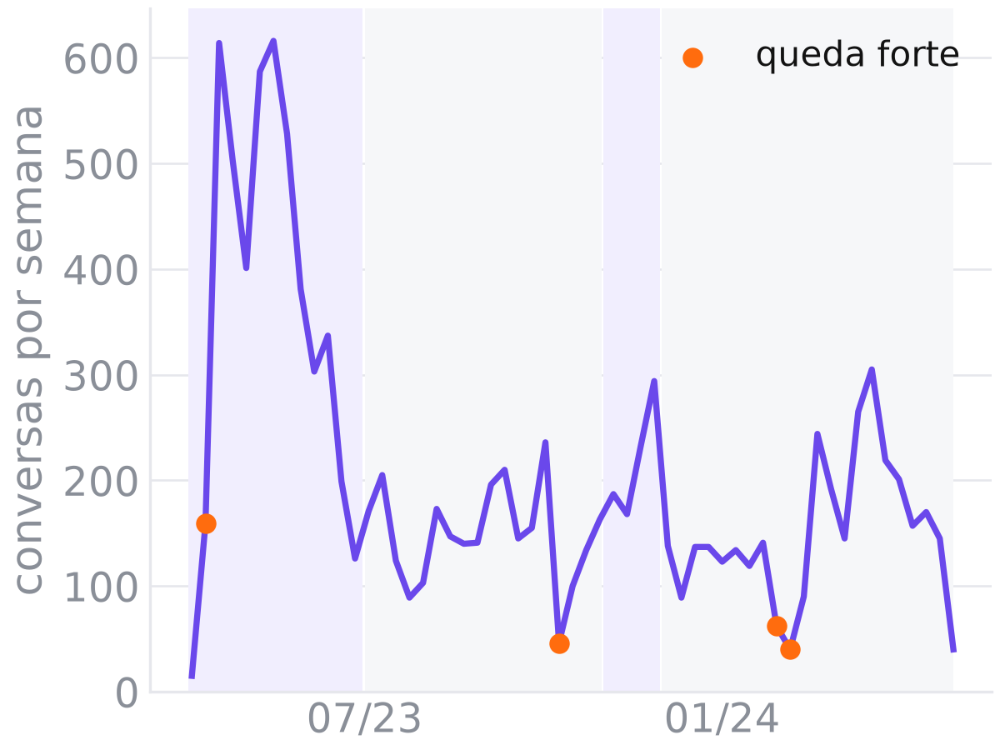
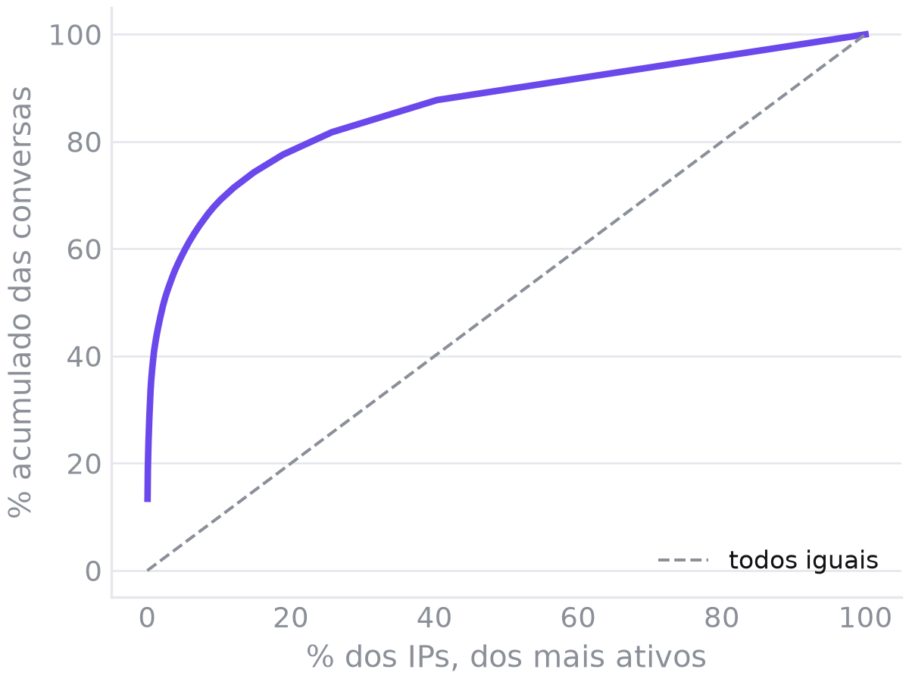
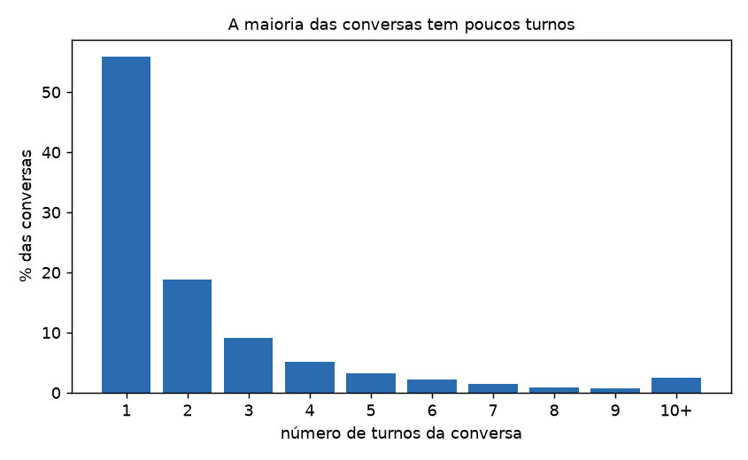
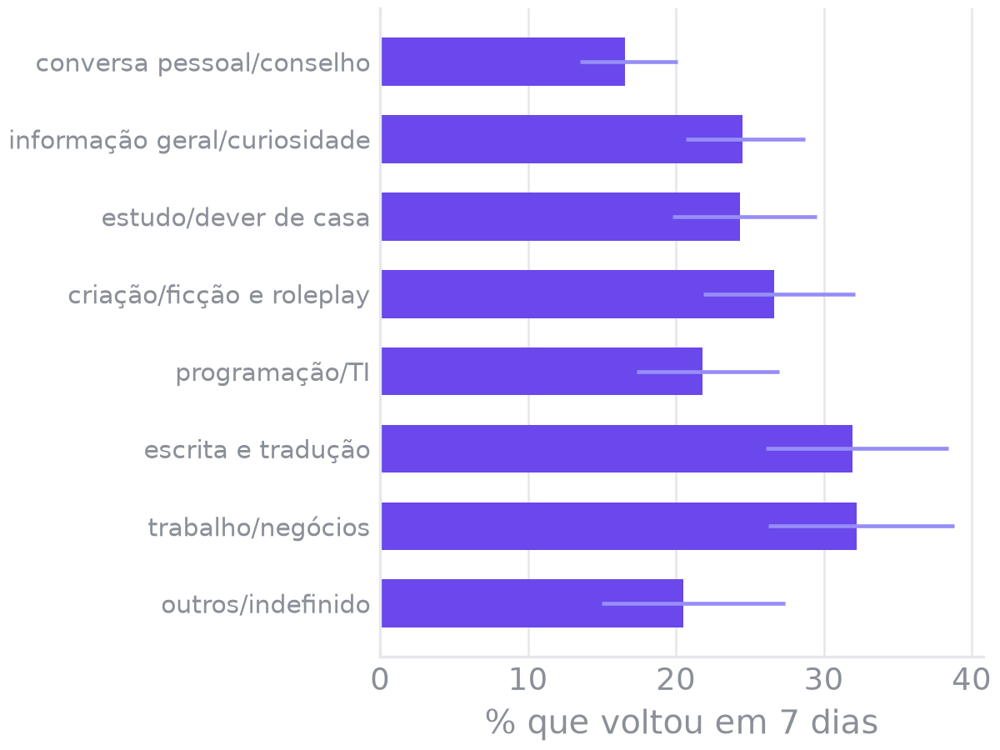
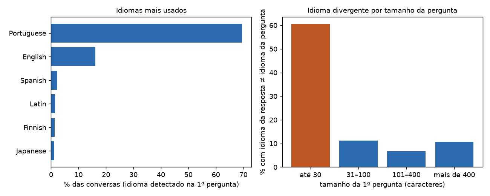

# O que faz uma pessoa voltar ao assistente em até 7 dias

Vinícius Souza · Desafio técnico Acaso · novembro de 2026

## A resposta em uma página

> De cada 100 pessoas que experimentam o assistente, **24 voltam em até 7 dias**. Só uma coisa que o assistente faz afasta de forma clara: **recusar a primeira pergunta**.

| Número | O que é | Base |
|---|---|---|
| **23,9%** | voltam em até 7 dias | 566 de 2.372 pessoas · margem: 22,2% a 25,6% |
| **−16** | voltam a menos, a cada 100, depois de uma recusa | entre 11 e 21 · pessoas parecidas |
| **Sem ganho** | de retorno com o GPT-4 no lugar do GPT-3.5 | −2,9 pontos (−8,0 a +2,2) |
| **1 de 33** | semanas com queda fora do normal | o acaso sozinho produz 2 |

| Achado | O que vi | Decisão que sustenta |
|---|---|---|
| **1. A recusa afasta** | Com recusa na primeira resposta, 13 de 132 voltaram (9,8%). Sem recusa, 553 de 2.240 (24,7%). | Acompanhar a taxa de recusa e testar uma recusa que ofereça alternativa. |
| **2. Modelo mais caro não trouxe retorno** | GPT-4 contra GPT-3.5: −2,9 pontos (−8,0 a +2,2). Ganho acima de 2 pontos está descartado. | Não justificar modelo mais caro por retenção. |
| **3. Semana ruim sozinha engana** | A maior queda da série era efeito do início da coleta. A de 20/11/2023 ficou dentro da variação normal. | Alerta só acima da variação normal. |

```fluxo
WildChat, só Brasil: 11.621 conversas -> 2.372 pessoas novas -> 25 comparações entre pessoas parecidas -> 1 se sustenta: a recusa
```

Limite: é comparação, não experimento. Os dados não provam causa nem mostram efeito menor que 5 pontos. Entrego base em Postgres, API e painel de 3 telas, que sobem com `docker compose up`.

## 1. Definições e o que muda se eu estiver errado

> Só uma escolha move o número: o que se chama de voltar. A resposta honesta é "entre 17% e 24%".

| Premissa | Minha escolha | Taxa com a alternativa (oficial: 23,86%) |
|---|---|---|
| Usuário | IP + família do navegador, sem versão | só IP: 23,94% · navegador completo: 25,14% |
| Sessão | 30 min sem uso encerra | 60 min: 21,54% |
| Primeira experiência | a primeira conversa da primeira sessão | não muda a taxa; muda os fatores |
| Voltar | nova sessão em até 7 dias | só em outro dia: 16,86% |
| Uso | 1 pergunta não vazia e 1 resposta | contando vazias: 23,69% |
| Início da base | 14 primeiros dias fora | sem corte: 24,01% · 28 dias: 23,70% |
| Robôs | IP com 200+ conversas ou 10+ navegadores fica fora | com eles: 24,08% |
| Fuso | São Paulo | UTC: mesma taxa |

As opções que considerei em cada uma estão em `docs/decisoes/` (BDR-01 a 07).

## 2. O que os dados mostram

> Uso concentrado em poucos IPs, conversas curtas, pouca gente por semana. Boa parte do sobe e desce semanal é ruído.








| Variável da primeira experiência | Como é derivada |
|---|---|
| Modelo | GPT-3.5 (1.340 pessoas) ou GPT-4 (1.032) |
| Tema e recusa | classificados por LLM e conferidos à mão |
| Qualidade da resposta | não há nota do usuário; uso recusa e resposta em outro idioma |
| Tamanho | caracteres da pergunta e da resposta, em faixas |
| Turnos | trocas na primeira sessão; é sinal de interesse, não fator do assistente |
| Horário, idioma, aparelho, região | hora no fuso de São Paulo, idioma detectado, navegador e estado |

Conferi a IA rotulando 200 conversas à mão, sem ver a resposta da máquina. Na recusa, as regras de palavras-chave acertavam 81% e o LLM acertou 92%; de cada 10 recusas que ele aponta, cerca de 8 são de fato. No tema o LLM acerta 56%, por isso o tema fica só como descrição. A troca mudou o resultado: com as regras, o efeito da recusa parecia 3,3 pontos.

| Problema de qualidade | Tamanho | O que fiz |
|---|---|---|
| Uso com cara de robô | 7 IPs, 28% das conversas | fora da conta |
| Idioma mal detectado em pergunta curta | 964 conversas | fator só usa perguntas com mais de 30 caracteres |
| IP muda no meio da conversa | 175 | uso o IP mais frequente |
| Pergunta vazia · texto repetido · dado removido | 141 · 93 · 56 | mantidas e contadas |
| Conversas tóxicas removidas na origem | não sei quantas | limite: é nelas que a recusa é mais comum |

Faltam: ID de login, versão do produto por data, satisfação declarada e o motivo da saída.

## 3. O que pesa no retorno

> De 25 efeitos entre pessoas parecidas, só a recusa passa a correção para muitos testes.

Diferença na taxa de retorno, em pontos. O ajustado compara pessoas parecidas nos outros fatores e na época de chegada (regressão logística, erro agrupado por IP).

| Fator | Bruto | Ajustado (intervalo de 95%) | Leitura |
|---|---:|---|---|
| Recusa na 1ª resposta | −14,8 | **−16,4 (−21,4 a −11,5)** | se sustenta |
| Tema: conversa pessoal | −10,0 | −8,2 (−14,3 a −2,1) | não passa a correção |
| Resposta de 301 a 1.000 caracteres | +8,8 | +4,7 (−1,5 a +10,8) | o bruto enganava |
| GPT-4 contra GPT-3.5 | +0,1 | −2,9 (−8,0 a +2,2) | não difere de zero |
| Resposta com mais de 2.500 caracteres | +7,9 | +0,5 (−6,0 a +7,0) | o bruto enganava |
| Resposta em outro idioma | +3,0 | +0,1 (−7,7 a +7,9) | não difere de zero |

- Resposta longa parecia trazer 8 pontos. Entre pessoas parecidas, some: era o perfil de quem pergunta.
- A recusa fica entre −14,4 e −16,4 quando troco as definições. As 132 recusas vêm de 131 IPs.
- Isso não prova que a recusa cause a saída. Ela pode ser sinal de um pedido que o produto não atende. Só um teste controlado responde.
- Um segundo método, de ponderação, confirmou a leitura do modelo. Para a recusa ele não fecha, com só 132 casos.

## 4. A semana que caiu

> Nas duas semanas, a diferença é de comportamento, não de público, e nenhuma passa da variação normal.

| Semana | Retorno | Comparada com | Diferença | Público / comportamento | p |
|---|---|---|---:|---|---:|
| 20/11/2023 | 21,5% (n = 65) | 26,4%, 4 semanas anteriores | −4,9 | −0,4 / −4,4 | 0,43 |
| 01/05/2023 | 16,7% (n = 84) | 24,4%, 4 semanas seguintes | −7,7 | −0,6 / −7,1 | 0,13 |

A de 01/05 me enganou na primeira leitura: comparada com o começo da coleta, parecia cair 17 pontos.

## 5. O painel

> Três telas, cada uma com uma pergunta no título e a resposta em uma frase. Cabem sem rolar.


- O texto fala de pessoas ("16 a menos voltam, a cada 100"), não de pontos percentuais.
- Tudo é clicável. A caixa que abre traz definição, fórmula, denominador, período e a consulta SQL de cada indicador.
- Com pouca gente, o painel escreve "pouca gente" e não conclui.
- Texto de conversa, IP e navegador não aparecem em tela nem na API. O texto nem entra no banco.

## 6. Arquitetura e custo

```fluxo
Arquivo bruto -> Carga em Python -> Postgres -> Análise em Python -> Tabelas finais -> API Next.js, só leitura -> 3 telas
```

- Na AWS: RDS, containers, balanceador, S3 e Bedrock, por **US$ 54 por mês**. É desenho com custo calculado; não implantei.
- O LLM custou US$ 0,24 para 2.944 conversas.
- Os indicadores são calculados na carga. A API guarda as respostas em cache até a carga seguinte e informa o tempo em cada resposta e no log. A consulta principal foi de 12 s para 0,33 s.
- Outros países: o país já é parâmetro na base e na API. Textos da interface ficam em arquivo por idioma, o fuso é por país, e a comparação entre países usa a separação de público e comportamento da seção 4.
- Diagramas, modelo da base e endpoints: `docs/arquitetura/arquitetura.md`. Decisões: ADR-01 a 10.

## 7. Como eu saberia que um número está errado

- A cada carga, 9 contagens são refeitas direto do arquivo bruto e comparadas com a base. Hoje a diferença é zero nas 9.
- Cada camada deixa registro. Carga: arquivo, linhas lidas, gravadas e rejeitadas. Base: versão das definições e a conferência com a origem. API: log com identificador, tempo e versão dos dados. Tela: mostra o identificador quando dá erro.
- O caminho de investigação é tela, log, consulta, tabela, carga, arquivo.
- Testes travam as definições numa base inventada de resposta conhecida: 6 dias e 23 horas conta, 7 dias e 1 minuto não.
- Quebrei as regras de propósito para testar os testes. Um não pegava a troca de `<=` por `<`, e corrigi.
- Até produção: a mesma imagem passa por local, homologação e produção. Mudança de banco é arquivo SQL numerado, com o passo inverso. Depois de implantar, rodam a verificação de saúde e a conferência com a origem.
- Não fiz: o envio automático do alerta, a execução dos passos de reversão do banco e a primeira rodada da integração contínua.

## 8. O incidente: a retenção caiu de 31% para 18%

> É erro de contagem, não de comportamento: quem voltou ficou igual; quem chegou quase dobrou, só no painel.

| Semana do incidente | Painel | Relatório do time de dados |
|---|---:|---:|
| Novos | 2.034 | 1.172 |
| Voltaram em 7 dias | 366 | 352 |

Começaria por essa comparação. Ela aponta a camada: a carga, na regra que define o usuário. O relatório conta por IP; a carga conta por IP mais o texto completo do navegador, e cada atualização do navegador vira uma pessoa nova. No dado real isso infla os usuários em 21% (`docs/incidente/confirmacao.sql`).

```python
chave = f"{hashed_ip}|{user-agent}"                                                    # antes
chave = "|".join([hashed_ip, familia_so(user_agent), familia_navegador(user_agent)])   # depois
```

- Além de corrigir: reprocessar o histórico e alinhar a definição de usuário com o time de dados. Para não voltar: a conferência automática e um teste que falha se alguém usar a chave antiga.
- À gerente, durante: "A queda é quase certamente de medição. Quem voltou não mudou, só quem chegou. Não decida em cima do 18%. Volto com a causa até tal hora."
- Depois: "Troca de navegador contava como usuário novo. Corrigimos, e os números que você já apresentou mudam assim."

## 9. Riscos e decisões que não são minhas

| Risco | Decisão a levar ao time e ao cliente |
|---|---|
| Sem login, a identidade erra para os dois lados | Definição oficial de usuário |
| O dado tem texto de conversa e IP | Retenção, base legal e o que pode ir para um LLM |
| Mudar o que é voltar muda o número oficial | Quem aprova mudança de definição |
| Com 2.400 usuários só se vê efeito grande | Se vale um teste no produto |
| Custo do LLM e carga em lote | Orçamento e prazo de atualização |

## 10. Sugestões

- Assistente: revisar recusas desnecessárias e testar uma recusa que ofereça alternativa. Olhar a conversa pessoal, o tema que menos volta (17%).
- Painel: mostrar a taxa de recusa e o "voltou em outro dia" ao lado da taxa oficial.

## 11. Uso de IA e horas

Usei o Claude Code para planejar e escrever código e testes, e um LLM para classificar tema e recusa. A IA propôs opções; eu escolhi e respondo pelas conclusões. Conferi com 200 rótulos feitos à mão, uma base inventada de resposta conhecida e a conferência com o arquivo bruto. O que corrigi ou descartei:

- O primeiro cálculo de efeito dava 7,0 pontos onde o certo era 10,1. O teste pegou.
- Descartei o classificador por palavras-chave e um segundo LLM que deixava 40% sem resposta.
- Reprovei duas versões do painel por estarem técnicas demais.

Foram cerca de **22 horas**, acima das 12 sugeridas: rotulei 200 conversas à mão e refiz as telas até ficarem claras. Onde está cada item do enunciado: `docs/mapa_enunciado.md`.
